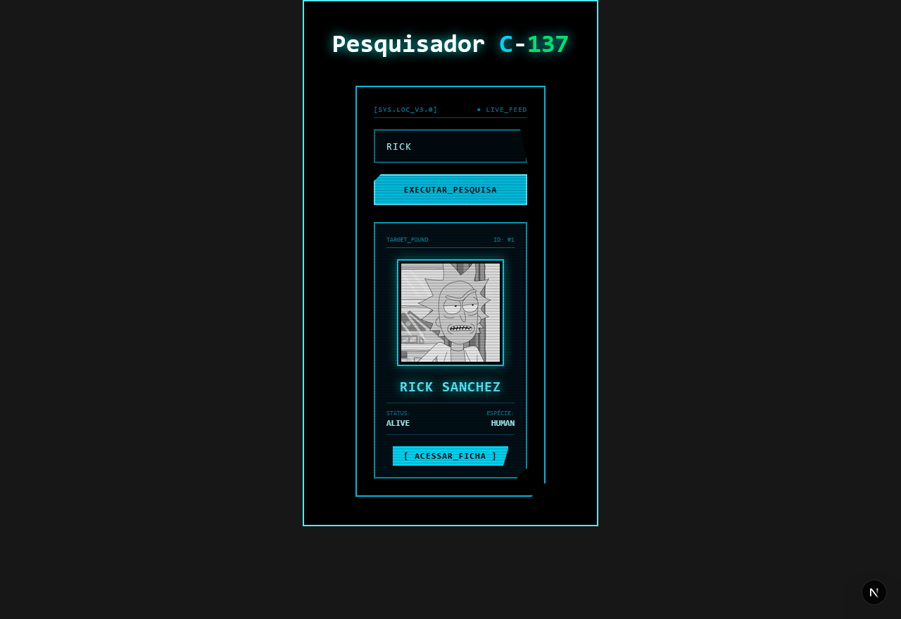

# 🧪 Rick-e-Morty-Searcher

> Um pesquisador de personagens de **Rick and Morty** desenvolvido com **Next.js**, utilizando rotas dinâmicas e a API de Rick and Morty.

O **Rick-e-Morty-Searcher** permite pesquisar e visualizar informações sobre diferentes personagens da série, utilizando dados obtidos diretamente através da API.

---

## 📸 Preview

## 📸 Preview




---

## 🎯 Objetivo do projeto

Este projeto foi desenvolvido para praticar **Next.js**, principalmente o uso de **Dynamic Routes**, consumo de APIs e criação de páginas dinâmicas baseadas nos dados recebidos.

---

## ✨ Funcionalidades

- 🔍 Pesquisa de personagens
- 👽 Visualização de informações dos personagens
- 🌐 Consumo da Rick and Morty API
- 🔗 Dynamic Routes para páginas individuais
- ⚡ Interface dinâmica e responsiva

---

## 🛠️ Tecnologias utilizadas

- Next.js
- React
- JavaScript
- CSS
- Rick and Morty API

---

## 📂 Estrutura do projeto

```text
rick-e-morty-searcher/
│
├── public/
├── src/
│   ├── app/
│   ├── components/
│   └── ...
├── package.json
└── README.md
```

---

## 🚀 Como executar

1. Clone o repositório:

```bash
git clone https://github.com/iamT0ddykk/Rick-e-Morty-Searcher.git
```

2. Entre na pasta:

```bash
cd Rick-e-Morty-Searcher
```

3. Instale as dependências:

```bash
npm install
```

4. Inicie o servidor de desenvolvimento:

```bash
npm run dev
```

5. Acesse no navegador:

```text
http://localhost:3000
```

---

## 📚 O que foi praticado

- Desenvolvimento com Next.js
- Dynamic Routes
- Consumo de APIs
- Componentização com React
- Renderização de páginas dinâmicas
- Manipulação de dados vindos de uma API

---

## 🔗 Repositório

[**GitHub - Rick-e-Morty-Searcher**](https://github.com/iamT0ddykk/Rick-e-Morty-Searcher)

---

## 👨‍💻 Autor

Desenvolvido por **iamT0ddykk**

🔗 [GitHub](https://github.com/iamT0ddykk)

Se este projeto foi útil ou interessante, considere deixar uma ⭐ no repositório.

---

## 📄 Licença

Este projeto está licenciado sob a licença MIT.
